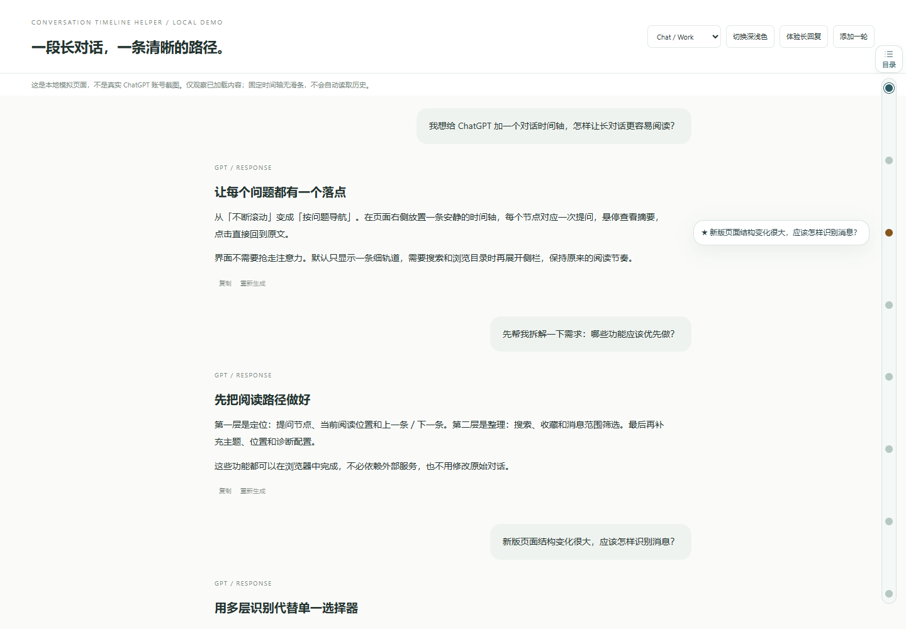
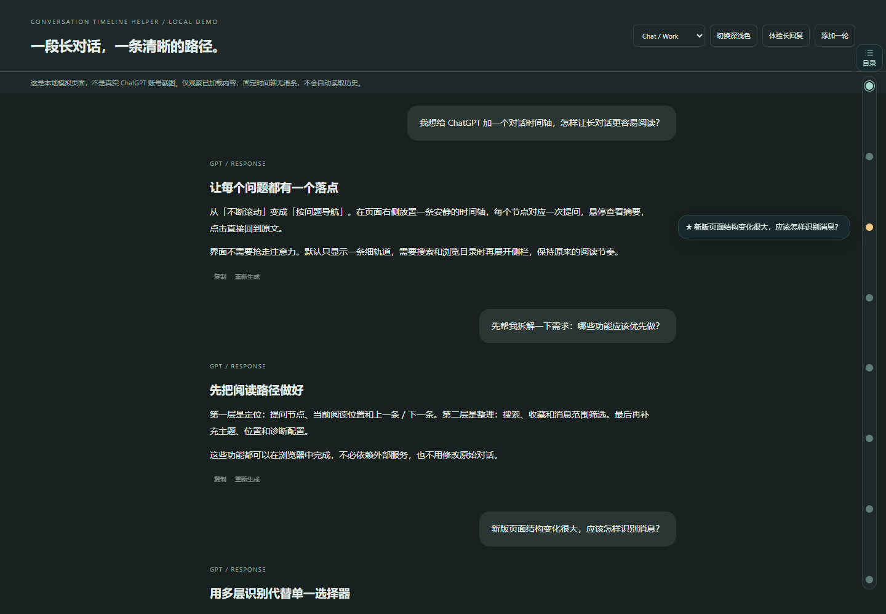
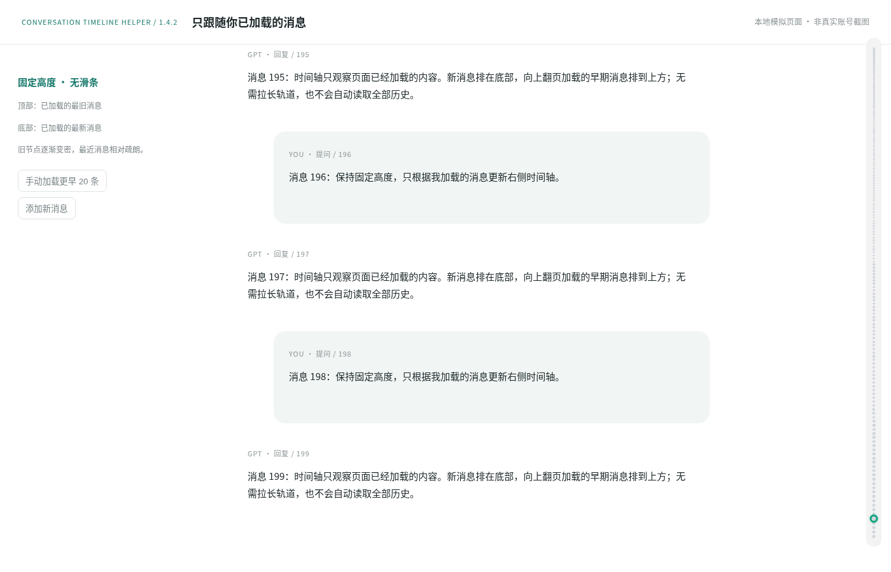
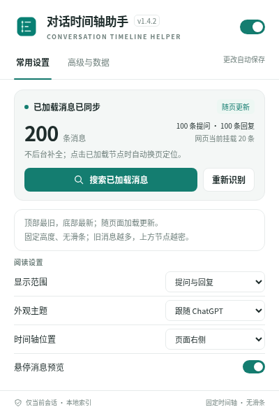

# 对话时间轴助手

**面向最新版 ChatGPT 网页，持续适配与更新。**

**Conversation Timeline Helper** — 为 ChatGPT 网页提供对话时间轴、消息搜索与本地收藏的非官方浏览器扩展。

长对话里，用固定高度的时间轴找到已经看过的消息。顶部对应本页加载过的最旧消息，底部对应最新消息；消息变多时，较旧节点逐渐压密，无需拖动时间轴内部滑条。

[产品网站](https://644866730.github.io/conversation-timeline-helper/) · [隐私政策](https://644866730.github.io/conversation-timeline-helper/privacy.html) · [使用帮助](https://644866730.github.io/conversation-timeline-helper/support.html) · [问题反馈](https://github.com/644866730/conversation-timeline-helper/issues)

## 可以做什么

- **对话导航**：点击节点定位原消息，悬停查看预览；支持主题、显示范围、位置及快捷键设置。
- **消息搜索与收藏**：搜索本页加载过的内容；收藏设置保存在当前浏览器本地。
- **按需定位旧节点**：点击已观察过的旧消息时，尝试利用网页原生分页或虚拟列表恢复并验证位置，支持取消。
- **预览位置保护**：v1.4.2 在图片、附件预览等原生弹窗打开时暂时隐藏时间轴，并在关闭后短暂校正阅读位置。
- **持续更新维护**：以最新版 ChatGPT 网页为主要适配目标，持续跟进界面、消息结构与预览交互的变化，维护并改进兼容性。
- **无需构建**：原生 JavaScript、CSS 与 Manifest V3；安装和使用不需要 Node.js、Python、服务器或额外 API Key。

扩展只观察当前页面已加载的消息，不扫描账户中的其他会话，不在后台补全全部历史，也不是聊天备份工具。

## 界面预览

以下图片来自本地模拟对话和模拟 Chrome API，用于展示界面；不代表已在登录后的真实 ChatGPT 账户中完成验收。



<details>
<summary>查看更多界面</summary>







</details>

## 安装源码版本

当前源码版本：**1.4.2**；最低 Chrome 版本：**120**。源码公开不代表该版本已经通过 Chrome 网上应用店审核。

1. 在本仓库点击 **Code → Download ZIP** 并解压，或执行下方克隆命令。
2. 在 Chrome 打开 `chrome://extensions/`，开启「开发者模式」。
3. 点击「加载已解压的扩展程序」，选择仓库内的 **`extension` 文件夹**，该文件夹直接包含 `manifest.json`。
4. 刷新已经打开的 ChatGPT 标签页，再进入一段包含多条消息的对话。

```sh
git clone https://github.com/644866730/conversation-timeline-helper.git
```

从旧本地版本迁移前，请先导出收藏备份。不同扩展 ID 的数据不会自动继承；不要同时启用多个版本。详细步骤见 [安装与迁移说明](extension/INSTALL.txt)。

常用快捷键：`Alt + Shift + T` 打开目录，`Alt + Shift + F` 搜索。快捷键可能与系统或浏览器冲突，可在设置中调整或关闭；按 `Esc` 可取消正在进行的节点导航。

## 隐私与权限

内容脚本仅匹配 `chatgpt.com` 与 `chat.openai.com`，显式 API 权限为 `storage`。

聊天正文、搜索状态与临时阅读锚点只在当前标签页内存中处理。持久存储仅保存设置、收藏匹配指纹和收藏时间，不保存聊天正文或搜索词，不使用 `chrome.storage.sync` 自动同步。

扩展运行代码不向开发者服务器发送聊天或使用数据，没有遥测、广告分析和远程可执行代码。主动点击旧节点可能触发 ChatGPT 网页自身的原生加载；网站访问与主动支持邮件另见[完整隐私说明](extension/PRIVACY.md)。

## 目录结构

```text
.
├── README.md / LICENSE / CONTRIBUTING.md / SECURITY.md
├── extension/             # 可直接加载的扩展工程
│   ├── manifest.json
│   ├── src/               # 索引、导航、弹窗位置保护与样式
│   ├── popup/             # 设置、收藏备份与诊断
│   ├── icons/
│   ├── demo/              # 离线模拟页面
│   ├── tests/             # Node 检查与本地浏览器场景
│   ├── tools/             # 样式同步与打包
│   ├── docs/              # 设计、兼容性及测试记录
│   └── vendor/reborn14/   # 上游许可与样式参考
└── index.html / privacy.html / support.html / site.css
                           # GitHub Pages 公开网站
```

## 开发与测试

安装扩展无需运行这些命令。开发测试使用 Node.js 18+ 和 Python 3.9+；浏览器测试另需 Playwright 与 Chromium。

```sh
cd extension
npm test
```

Node 检查无第三方 npm 依赖，无需先执行 `npm install`。修改样式时编辑 `src/shell.css` 或 `src/extras.css`，然后执行 `npm run styles`，重新生成 `src/timeline.css` 和 `src/styles.js`。直接修改生成文件会在下次同步时被覆盖；上游样式参考保存在 `vendor/reborn14/`，请保留来源与许可说明。

可选浏览器测试：

```sh
python -m pip install -r tests/requirements.txt
python -m playwright install chromium
python tests/browser_test.py
python tests/loaded_browser_test.py
python tests/navigation_browser_test.py
python tests/preview_browser_test.py
```

已有测试报告保留在 [docs/TEST_REPORT.md](extension/docs/TEST_REPORT.md)。报告中的浏览器结果来自本地模拟，不是所有账户或灰度页面的兼容保证。开源整理时重新运行 Node 检查：91 项通过；未重新运行浏览器回归。

## 打包

在 `extension` 目录运行：

```sh
# 商店上传包：manifest.json 位于 ZIP 根目录，仅包含运行与许可文件
python tools/package_store.py --output ../dist/Conversation-Timeline-Helper-v1.4.2-store-upload.zip

# 完整工程包：包含源码、测试、演示和开发文档
python tools/package.py --output ../dist/Conversation-Timeline-Helper-v1.4.2-source.zip
```

两个包的用途不同。仓库根目录的网站文件用于 GitHub Pages；不要把整个仓库 ZIP 当作商店上传包。

## 已知限制与反馈

项目持续维护，版本改进与兼容修复记录在 [CHANGELOG.md](extension/CHANGELOG.md)。遇到新版 ChatGPT 的界面或交互兼容问题，欢迎通过 Issues 提供不含私人信息的复现步骤。

ChatGPT 的页面结构、灰度界面和虚拟列表可能变化，影响消息识别或导航。未加载的历史、已删除消息和隐藏分支不会被自动恢复。弹窗关闭后的校正有时间限制，不会无限锁住用户滚动；新的手动操作会终止校正。

v1.4.2 的修复机制与边界见 [PREVIEW_FIX.md](extension/docs/PREVIEW_FIX.md)。发布前仍需在真实账户中检查图片关闭、Esc、背景关闭与旧节点导航。

欢迎通过 [Issues](https://github.com/644866730/conversation-timeline-helper/issues) 反馈问题。请提供浏览器/扩展版本、复现步骤、预期与实际结果；截图和诊断请先去除私人聊天、Cookie、密码和令牌。贡献流程见 [CONTRIBUTING.md](CONTRIBUTING.md)。安全问题请按 [SECURITY.md](SECURITY.md) 私下联系。

## 许可证与致谢

本项目沿用 [MIT 许可证](LICENSE)，保留既有版权声明。部分样式与交互改编自 [Reborn14 / ChatGPT Conversation Timeline](https://github.com/Reborn14/chatgpt-conversation-timeline)，上游 MIT 许可保留在 [extension/vendor/reborn14/LICENSE](extension/vendor/reborn14/LICENSE)。详见 [第三方代码与致谢](extension/THIRD_PARTY_NOTICES.md)。

本项目与 OpenAI、ChatGPT、Reborn14 均无官方隶属、赞助或认可关系。

维护者：**GCH** · 支持与隐私联系：**NikieRamamonjisoa@gmail.com**
