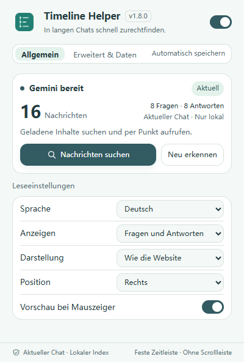

# 对话时间轴助手 · v1.8.0

**Conversation Timeline Helper** — 为 ChatGPT 与 Gemini 网页提供时间轴、消息搜索、收藏和章节导航的非官方 Manifest V3 扩展，适用于 Microsoft Edge 与 Chrome。

固定高度、无滑条：顶部对应本页加载过的最旧消息，底部对应最新消息；消息增多时，旧节点逐渐压密。只观察当前页面实际加载内容，不扫描账号中的其他会话，不后台补全全部历史。

[产品网站](https://644866730.github.io/conversation-timeline-helper/) · [隐私政策](https://644866730.github.io/conversation-timeline-helper/privacy.html) · [English privacy policy](https://644866730.github.io/conversation-timeline-helper/privacy-en.html) · [使用帮助](https://644866730.github.io/conversation-timeline-helper/support.html) · [问题反馈](https://github.com/644866730/conversation-timeline-helper/issues)

## 功能

- **对话时间轴与目录**：按提问与回复定位原消息，悬停预览，搜索关键词及上下文高亮。
- **收藏与章节**：本地星标、收藏筛选和备份；展开回复的真实标题，直接定位小节。
- **密集节点精确选择**：在附近消息列表中逐组选择，支持键盘操作。
- **返回阅读处**：查阅旧消息后恢复主动跳转前的相对阅读位置，最近最多 20 次，仅存当前标签页内存。
- **Markdown 导出**：保存当前显示、搜索、收藏或附近列表中的已加载消息，尽量保留标题、代码块和表格。
- **八种界面语言**：简体中文、繁体中文、英语、日语、韩语、西班牙语、法语、德语，或跟随浏览器。自动保存并更新已打开的时间轴，聊天正文和章节原文不翻译。
- **阅读体验**：Soft Utility 风格、深浅主题、左右位置、快捷键、图片与附件预览位置保护。

支持 `chatgpt.com`、`chat.openai.com`、`gemini.google.com`。点击观察过的旧节点时，扩展尝试通过原生分页/滚动或 ChatGPT 虚拟列表恢复原消息，成功前校验实际 DOM，可随时取消。Gemini 仅用 DOM 和用户主动选择后的原页面滚动，不注入 ChatGPT MAIN 助手。

## 界面预览

以下是本地合成对话或模拟扩展状态的 UI 渲染，不是 Microsoft 认证、商店安装或所有真实账号的兼容证明。


<details>
<summary>查看多语言设置</summary>




</details>

## 安装源码版本

当前版本 **1.8.0**，清单最低 Chromium 版本要求为 **120**。公开源码和网站不代表此版本已通过 Edge Add-ons 或 Chrome 网上应用店审核。

1. 使用 **Code → Download ZIP** 并解压，或克隆本仓库。
2. 在 Edge 打开 `edge://extensions/`，或在 Chrome 打开 `chrome://extensions/`，开启开发者模式。
3. 选择「加载解压缩的扩展」或「加载已解压的扩展程序」，选择仓库的 **`extension` 文件夹**，其中直接包含 `manifest.json`。
4. 刷新 ChatGPT 与 Gemini 已打开的标签页，进入一段含多条消息的对话。

```sh
git clone https://github.com/644866730/conversation-timeline-helper.git
```

更新前先导出收藏备份，在扩展管理页重新加载后刷新网页。不同扩展 ID 的数据不会自动继承，不要同时启用多个版本。详见 [安装与迁移说明](extension/INSTALL.txt)。

`Alt+Shift+T` 打开目录，`Alt+Shift+F` 搜索，`Alt+Shift+↑/↓` 切换消息；按 `Esc` 可取消定位。快捷键可能与系统或浏览器冲突，可在设置中关闭。

## 隐私与权限

内容脚本仅访问上述三个域名，唯一显式 API 权限是 `storage`。

聊天正文、搜索词和阅读锚点仅在当前标签页内存处理。持久存储只保存设置、收藏匹配指纹和收藏时间，不保存正文、搜索词或完整会话 URL，不用 `chrome.storage.sync`。指纹不是加密或匿名保证。

扩展不向开发者发送聊天或使用数据，没有遥测、广告分析或远程可执行代码。点击旧节点可能触发网站自身的原生加载。用户主动导出 Markdown 时，所选消息正文会写入本地文件；导出文件由用户保存、分享和删除。详见 [完整隐私说明](extension/PRIVACY.md)。

## 目录结构

```text
.
├── README.md / LICENSE / CONTRIBUTING.md / SECURITY.md
├── extension/              # 可直接加载的扩展工程
│   ├── manifest.json
│   ├── src/                # 索引、导航、主题与离线国际化
│   ├── popup/              # 设置、语言、收藏备份与诊断
│   ├── icons/ / demo/      # 图标与本地模拟页面
│   ├── tests/ / tools/     # 回归测试、样式生成和打包
│   ├── docs/               # 当前能力、验证边界及历史记录
│   └── vendor/reborn14/    # 上游许可与样式参考
└── index*.html / privacy*.html / support*.html / site.css
                            # GitHub Pages 中英文公开网站
```

## 开发与验证

安装和使用无需 Node.js、Python、后端或额外 API Key。开发测试使用 Node.js 18+ 和 Python 3.9+；浏览器场景另需 Playwright 与 Chromium。

```sh
cd extension
npm test
```

Node 检查无第三方 npm 依赖，无需 `npm install`。主题维护在 `src/theme.css`，时间轴规则在 `src/shell.css` / `src/extras.css`。修改后运行 `npm run styles`，生成 `src/timeline.css` 与 `src/styles.js`；不要只改生成文件。保留 `vendor/reborn14/` 的来源和许可。

```sh
python -m pip install -r tests/requirements.txt
python -m playwright install chromium
python tests/browser_test.py
python tests/loaded_browser_test.py
python tests/navigation_browser_test.py
python tests/preview_browser_test.py
python tests/gemini_browser_test.py
python tests/i18n_browser_test.py
```

v1.8.0 共 **300 项自动检查通过**：116 项 Node 检查、66 项基础浏览器场景、24 项已加载索引、25 项导航、27 项预览保护、24 项 Gemini 和 18 项国际化。浏览器结果来自真实 Chromium 渲染下的本地 DOM/Chrome API 模拟，不能视为原生 Edge 安装、跨浏览器重启持久化或所有真实账号灰度界面验收。当前验证说明见 [语言支持与验证记录](extension/docs/LANGUAGE_SUPPORT.md) 与 [兼容性边界](extension/docs/COMPATIBILITY.md)；历史版本报告保留在 `extension/docs/`，不代表当前版本的额外验收。

## 打包

在 `extension` 目录运行：

```sh
# 商店上传包：manifest.json 在 ZIP 根目录，仅运行与许可文件
python tools/package_store.py --output ../dist/Conversation-Timeline-Helper-v1.8.0-store-upload.zip

# 完整工程包：含源码、测试、演示与开发文档
python tools/package.py --output ../dist/Conversation-Timeline-Helper-v1.8.0-source.zip
```

不要把整个仓库 ZIP 或带顶层目录的源码包作为商店上传包。网站页面和内置隐私披露应保持一致；商店分发、审核与更新由对应平台处理。

## 已知限制与反馈

网页结构、虚拟列表和账号灰度界面会变化，可能影响识别或定位。未加载历史、已删除消息或隐藏分支不会被自动恢复。预览关闭后的校正有时间限制，新手动动作会终止校正。

兼容性改进见 [更新记录](extension/CHANGELOG.md)。通过 [Issues](https://github.com/644866730/conversation-timeline-helper/issues) 反馈普通问题；请提供扩展/浏览器版本、操作步骤和预期/实际结果。分享诊断或截图前移除私人聊天、Cookie、密码和令牌。贡献见 [CONTRIBUTING.md](CONTRIBUTING.md)，安全问题见 [SECURITY.md](SECURITY.md)。

## 许可证与发布者

沿用 [MIT 许可](LICENSE) 并保留已有版权声明。部分样式与交互改编自 [Reborn14 / ChatGPT Conversation Timeline](https://github.com/Reborn14/chatgpt-conversation-timeline)，上游 MIT 许可在 [extension/vendor/reborn14/LICENSE](extension/vendor/reborn14/LICENSE)。详见 [第三方说明](extension/THIRD_PARTY_NOTICES.md)。

与 Microsoft、OpenAI、ChatGPT、Google、Gemini、Reborn14 均无官方隶属、赞助或认可关系。

公开发布者：**GuanChanghao** · 支持与隐私联系：**NikieRamamonjisoa@gmail.com**
