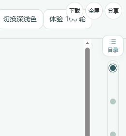

# v1.8.1 · 目录入口位置修复

目录入口原来距离页面顶部 8px，可能与 ChatGPT 或 Gemini 的下载、全屏等原生按钮重叠。现在入口下移到顶部 72px，时间轴相应从 124px 开始，两者之间留出 8px，底部仍保留 40px。

轨道始终保持当前屏幕内固定高度。消息数量增加不会使轨道变长；左右停靠、最旧和最新消息端点、搜索与密集节点选择沿用原有行为。

更新或重新加载扩展后刷新对话网页，才会使用新位置。无需重新配置语言或收藏。

## 本次验证 · 2026-11-16

- Node 核心与工程检查：116 项通过。
- ChatGPT 本地浏览器回归：66 项通过。
- 已加载消息、固定轨道与窗口缩放：24 项通过。
- 八语言 350px 窄目录布局：1 项通过。
- ego-browser 本地合成页面：顶部下载、全屏和分享三个按钮均可点击，目录入口与原生按钮无重叠，入口与轨道保留 8px 间隔。

共 207 项自动检查通过。其他测试保留 1.8.0 基线记录，不代表本次重新执行。测试使用本地 DOM 和模拟扩展 API，未进行原生 Edge 安装及所有真实账号灰度界面的完整验收。

