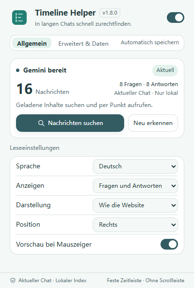
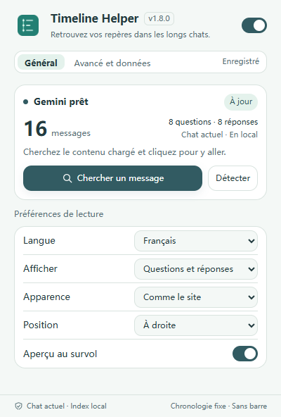

# 1.8.0 · 界面语言

在扩展弹窗或独立设置页打开「常用设置 → 界面语言」。选择后自动保存，已打开的 ChatGPT 与 Gemini 时间轴即时更新。首次更新扩展后需要刷新网站，以便加载新脚本；以后仅切换语言无需刷新。

## 支持范围

| 语言 | 菜单名称 |
| --- | --- |
| 简体中文 | 简体中文 |
| 繁体中文 | 繁體中文 |
| 英语 | English |
| 日语 | 日本語 |
| 韩语 | 한국어 |
| 西班牙语 | Español |
| 法语 | Français |
| 德语 | Deutsch |

默认「跟随浏览器」按浏览器语言偏好顺序匹配；中文区分 Hans/Hant，未指定文字体系时根据地区区分简繁。不支持的语言回退英语。明确选择某种语言后，不随浏览器语言变化。

设置页、时间轴目录、消息角色标签、搜索提示、收藏按钮、章节操作、定位进度、空状态、无障碍标签及 Markdown 导出说明都使用所选语言。聊天正文、章节原文、图片描述及搜索词不会翻译。浏览器扩展管理页中的产品名称和静态隐私政策保留中文；隐私全文入口标注「中文」。诊断 JSON 的技术字段名保持稳定。

语言切换保留搜索、收藏、目录开关、已展开章节和当前阅读位置；独立设置页的当前分类和未保存选择器草稿也保留。

## 本地保存

语言偏好使用 `chrome.storage.local` 的 `gtn:setting:language` 键，与其他设置一起保存在当前浏览器配置中。恢复默认设置会恢复为跟随浏览器。全部译文随扩展提供，不连接翻译服务、不新增权限、不持久保存聊天正文，收藏 v1 备份格式保持兼容。

## 验证记录 · 2026-11-16

- Node 核心、工程与离线字典：116 项通过，包含语言校验、存储往返、显式中文文字体系、逐语言字典完整性、插值与安全检查。
- ChatGPT 基础浏览器回归：66 项通过。
- 已加载索引：24 项通过；按需导航：25 项通过；原生预览位置保护：27 项通过。
- Gemini 浏览器回归：24 项通过。
- 国际化专项：18 项通过，覆盖两个平台八语言即时切换、本地偏好重用、无效设置、浏览器动态语言变化、搜索/收藏/焦点保留、安全原文和独立设置页草稿。
- 八语言在连接与未连接两种状态的 400×592 弹窗布局均通过，350px 宽目录无横向溢出。
- 使用 ego-browser 查看英语、日语时间轴、德语窄屏目录，以及德语和法语设置页。截图使用本地合成对话与模拟扩展 API。

共 300 项自动检查通过。运行结果位于源码包的 `tests/results/`；国际化专项记录为 `i18n-browser-results.json`。

这些检查使用真实 Chromium 渲染和本地 DOM/Chrome API 模拟，未在本次完成原生扩展安装、跨浏览器重启持久化或所有真实账号灰度界面验收。语言文案已做字典完整性和界面检查，未经过各语种专业译审。隐私政策全文不随界面语言切换。

